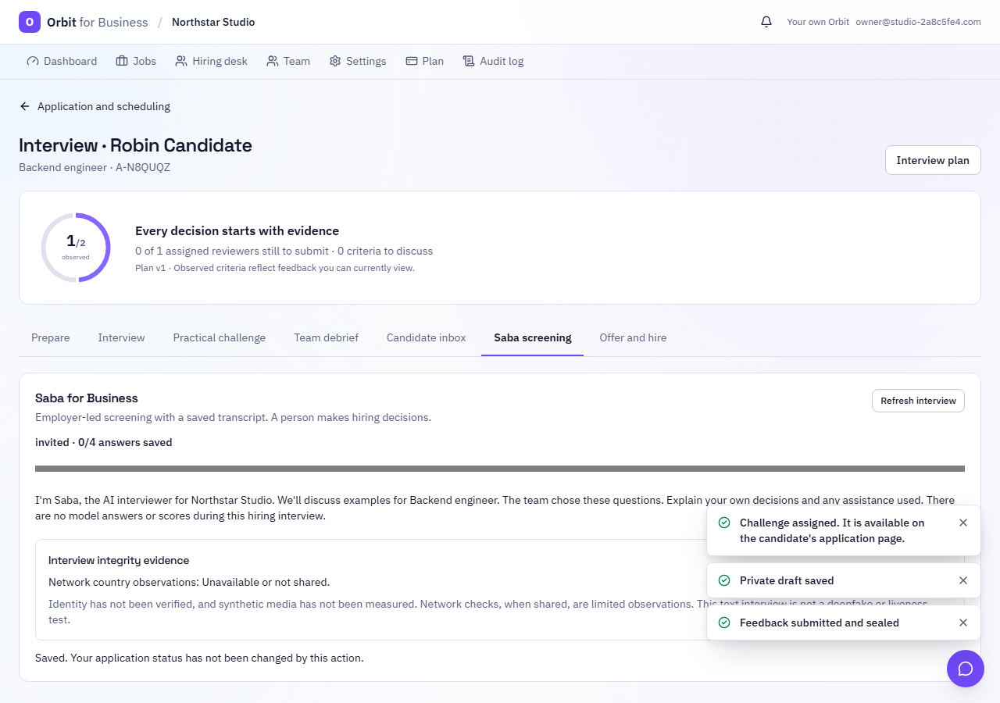
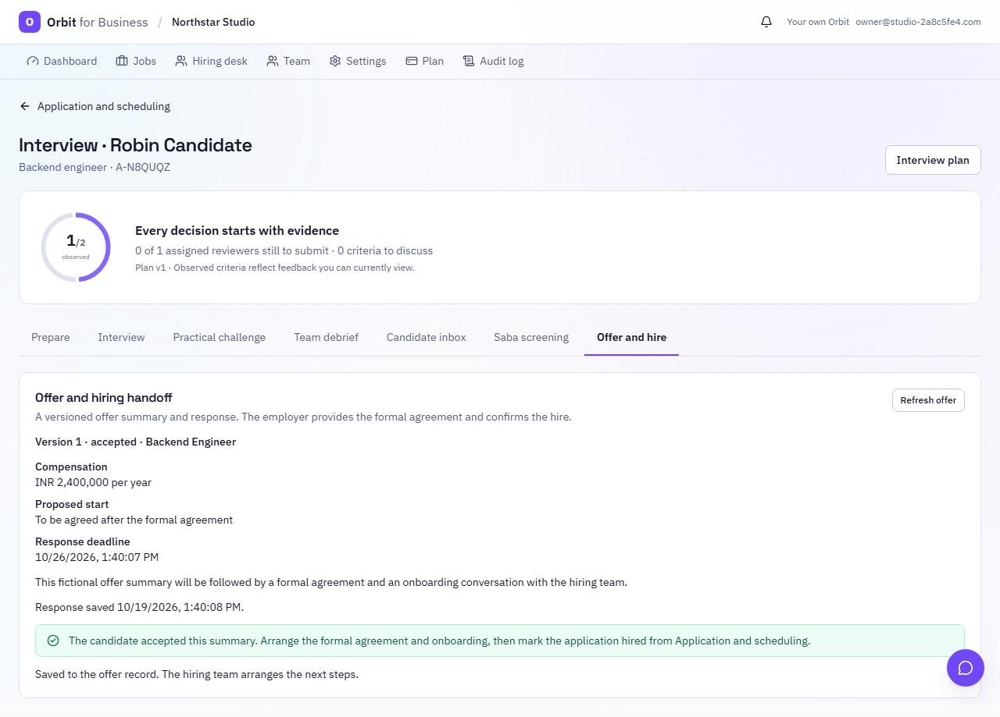
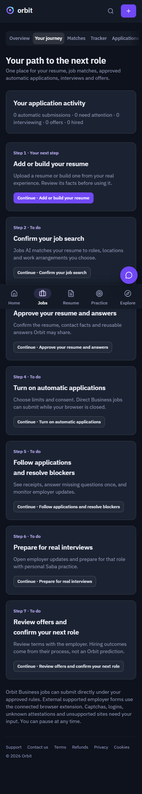

# Hiring and candidate application cycle

This release extends [Hiring Studio](BUSINESS-HIRING-STUDIO.md) and [hiring operations](BUSINESS-HIRING-OPERATIONS.md).
For the subsequent joining-plan workflow and readable offer history, see [Joining plans](BUSINESS-JOINING-PLANS.md).
For candidate withdrawal and cancellation of outstanding interview invitations, see [Withdrawal](BUSINESS-WITHDRAWAL.md).
It adds Business Saba, reviewable integrity evidence, offer summaries, unattended first-party applications and a
candidate journey. Personal Saba's interviewer, practice prompts, voice controls and conversation engine are unchanged.

## Employer journey

1. Verify the company, publish a job and save its interview plan using the existing Business workspace.
2. Published jobs also enter Jobs AI as **Orbit for Business** listings. Editing, pausing and closing update that
   projection. The retention sweep backfills at most 200 older/changed listings per pass; it starts a minute after
   API startup and normally runs every six hours. Current job/company status is checked again when matching and sending.
3. A confirmed applicant can be invited from **Interview → Saba screening**. Saba uses the first three assessment
   areas and their approved probes, frozen at invitation time. There are at most six answers. The invitation lasts
   seven days; an expired, unfinished invitation can be extended without changing its original questions or answers.
4. Review the transcript, practical task, independent feedback and source quotes. Assigned interviewers can read
   the transcript and cite its exact words with the **Saba transcript** evidence source. Identity-review signals and
   the AI clarification report are restricted to members with applicant-management permission.
5. Record a human decision. New Saba answers, explanations and review records change its evidence snapshot, so a
   decision made before that evidence receives a review warning. Saba never changes a candidate's hiring status.
6. Use **Offer and hire** to publish a versioned summary: role, compensation/currency, start date, terms and deadline.
   Candidates accept or decline that exact version. Stale, expired, withdrawn and already-answered versions cannot
   receive a different response. Accepted summaries cannot be replaced or withdrawn through these endpoints.
7. Arrange the formal agreement and onboarding, then move the application to **Hired** using the existing pipeline.
   The candidate's Jobs AI tracker follows through to Hired. An accepted summary alone does not mark someone hired.

Offer summaries are not an electronic-signature service. Formal contracts, payroll, background checks, work-right
verification and HRIS provisioning remain separate employer processes. The desk surfaces completed Saba interviews,
requests for another interview format and offer responses within its existing bounded scan.

## Business Saba for candidates

- Review and accept the Business-specific notice. This is employer screening, without the personal practice
  product's ideal answers, coaching or scores. The hiring team chose the questions; no automated hiring verdict is made.
- Hear the questions with Aurora through the existing Deepgram voice provider, or choose device playback. Only the
  current server-held question can be synthesized. Natural voice is bounded by request/size/time limits and 500
  clips per company per UTC day. Missing configuration/provider failure leaves the text interview available.
- Type, use device dictation, or choose browser speech recognition where supported. Browser dictation has its own
  disclosure because audio may go to the browser's speech service. Stop and review the text before saving it.
  Orbit receives saved text rather than recording the candidate's audio/video. Real microphone behavior depends on
  browser support and permission; the browser test uses a recognition fixture.
- Answers are original records and cannot be overwritten. Retries preserve one answer, and simultaneous writes
  against an old revision conflict. Refresh retrieves saved answers and preserves unsent text in the current page.
- Request another interview format without sharing medical details. This pauses the Saba path and appears in the
  hiring desk; it does not reject the application. The team arranges the alternative through its existing scheduling tools.
- The same private application page contains questions/replies, interview activity and offer responses.

## Integrity evidence and limits

### Network observations

Network country is optional and comes only from a proxy-secret-authenticated Worker request. Arbitrary
`CF-IPCountry`, forwarded or client-supplied country headers are not accepted as evidence. Multiple countries can
reflect travel, routing or corporate networks; these observations do not establish residence or nationality.
Candidates can stop future country observations from the same panel. This does not change their hiring status;
previously collected records remain subject to the existing application retention/deletion process.

The separate optional **IPinfo Plus** check sends the current trusted public IP to IPinfo only after affirmative
consent. It saves a timestamped provider snapshot of VPN/proxy/Tor/relay flags, without putting the raw IP or API key
into Business events. One lookup is allowed per interview. Missing credentials, an untrusted/private address,
provider failure, a different subscription tier or partial data produce an unavailable result, never a clean result.
IPinfo's own processing and retention are governed by the configured provider agreement.

Set `ORBIT_BUSINESS_IPINFO_TOKEN` on the API only, with an account entitled to the Plus anonymity fields. Unset keeps
the optional check unavailable. It is not included in an asserted Business plan price or activated by this PR.
Provider documentation: [IPinfo Plus API](https://ipinfo.io/developers/plus-api).

### AI clarification report

After completion, a recruiter can request up to three job-related claim differences to clarify. The model receives
the transcript as delimited, untrusted data. Each item must cite exact passages from two distinct answer IDs and
ask a bounded question; unsupported citations and protected screening questions are refused. When AI is unavailable,
the transcript remains ready for human review. The report can be mistaken or miss inconsistencies; it is neither
a fraud score nor a hire/reject recommendation. An empty report does not verify a person's claims.

Human reviewers can save candidate-visible outcomes (**ask for clarification**, **context reviewed**, or
**inconclusive**). Candidates can append explanations or challenge an observation. Reviews are dated, associated
with the answer revision and flagged when more answers arrive. Original evidence remains intact.

### Deepfake and identity verification are not implemented

This release does **not** collect identity documents, match faces, run liveness tests, inspect candidate video,
detect synthetic voices or certify a person as genuine. The UI explicitly reports these as unmeasured/unverified.
Adding them requires a selected provider, credentials, a media/retention agreement and validation for the intended
use. [NIST's synthetic-content overview](https://www.nist.gov/publications/reducing-risks-posed-synthetic-content-overview-technical-approaches-digital-content)
describes a range of detection/provenance methods and their limitations. The
[Reality Defender API](https://docs.realitydefender.com/api-reference/quickstart) was investigated as a possible
integration, not connected or advertised as working. Country or VPN observations never automatically reject anyone.

## Personal Orbit: signup to applications and outcomes

- Default signup onboarding and the Jobs entry lead to **Your journey** (`/jobs/journey`). Explicit deep links to
  practice or other products are preserved. The journey asks for an uploaded/built resume, search preferences,
  approved facts/answers, campaign consent, applications, interview preparation and confirmed hiring outcomes.
- Resume AI and Jobs AI supply the existing building, tailoring, matching and preparation features. Hired is now a
  real tracker stage, including manually tracked external jobs. Hired entries are excluded from interview/follow-up reminders.
- Business jobs can submit without an open browser after email verification, an approved unchanged resume, current
  agency consent and the selected mode/filters. Review mode requires approval before a ready packet is sent.
- Supported external ATS forms still use the existing connected browser executor. An open browser/device is needed,
  but the user need not approve every supported form in Automatic mode. Unsupported sites, logins, captchas, unknown
  answers and unapproved attestations require the candidate. No passwords or captcha bypass were added.
- First-party dispatch and the browser executor share the account lock, daily quota, quiet hours and pacing gate.
  The sweeper checks ready direct packets independently of its three-hour planning interval, at most 20 accounts
  per pass, rotating through accounts so quiet hours or exhausted quotas cannot hold up later accounts.
  Application, tracker, submission receipt and quota commit together. Failed/duplicate attempts refund holds.
- Company/job status and current screening questions are checked before sending. Changed questions replace the
  packet's old form and require answers or review. Edits to the approved resume stop unattended dispatch until reapproved.
- Current agency consent is `2026-10-19.2`. Existing setups must review the updated notice to enable first-party
  submission. Legacy consent is never silently promoted by the dispatcher. Pause, consent changes, packet movement
  and executor result writes serialize with dispatch.

Automatic applications cannot guarantee interviews or employment. Business job projections currently use a single
country per listing; explicitly tagged/inferred city countries take precedence over the company's home country.
Complex multi-country onsite listings need a future per-country projection. No new external ATS submission API,
job-board automation, production scheduler service or deployment is claimed.

## Data and verification

No migration or new package dependency is required. Interview/offer/integrity records use application-scoped
`BizEvent` rows and the existing retention/deletion cascade. Audit entries contain references rather than transcript
or offer text. The native job projection uses the existing `job_listings` table and normal feed deduplication.
The Hired tracker value uses its existing string column; deploy the corresponding API and web types together.

`tests/test_business_career_cycle.py` covers consent, immutable/retried answers, network trust/consent, source quotes,
restricted identity signals, voice text restriction, offer versions/responses, first-party dispatch, review mode,
changed questions, pause/legacy consent/resume changes, concurrent workers and hired-state synchronization.
The Postgres CI lifecycle gate includes it. Tests use local email outboxes and recorded/mock providers, never real
candidate data or external application submissions. Local results and unavailable infrastructure are recorded in the PR.

### Local verification (2026-10-19)

- API Ruff, mypy (262 source files) and Bandit pass. Workspace TypeScript checks pass; lint has zero errors and
  two pre-existing hook warnings in SupportChat and SessionSetup.
- The full API run finished with 3,299 passed, 17 skipped and two old assertions that still rejected `hired`.
  Both assertions now accept the new stage and still reject unknown stages; the complete affected tracker
  modules pass (87 tests). A subsequent Business/candidate lifecycle, operations, studio and security run passes
  970 tests. After the final bounded-sweep fairness fix, all 13 candidate-cycle tests pass.
- All 1,261 frontend workspace tests pass. The web production/SSR build, 150-page prerender and bundle budget
  checks pass without increasing limits.
- Playwright passes the Business hiring cycle, including optional dictation with a fixture, offer response,
  mobile journey and accessibility checks. The two personal Saba conversation/voice browser scenarios also pass.
- PostgreSQL and Docker were unavailable locally. The CI PostgreSQL lifecycle gate includes the new test module;
  its actual hosted result must be checked on the PR. Provider calls in tests use fixtures, so live voice,
  microphone and IPinfo service behavior still require configured-environment acceptance checks.

Review screenshots use fictional people and employers:

