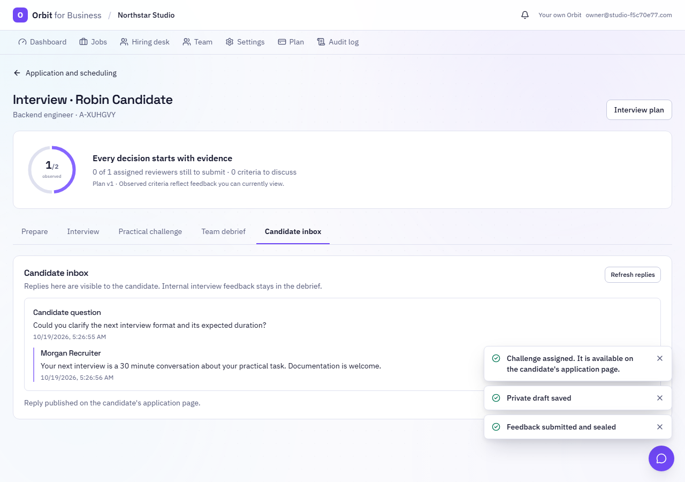
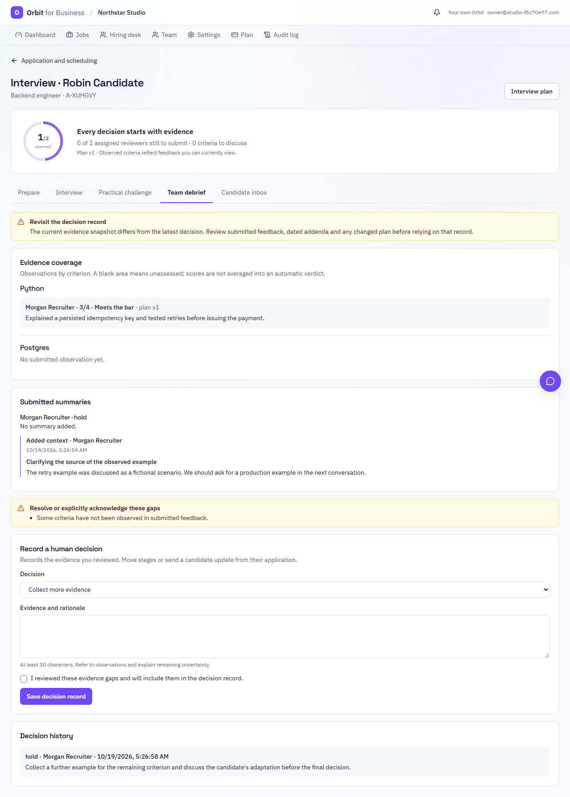
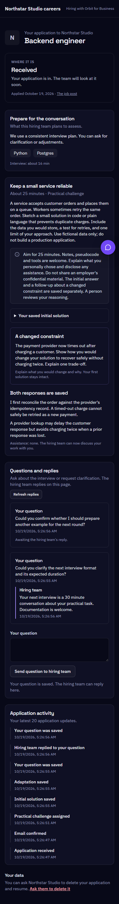

# Business hiring operations

This extends the [Hiring Studio](BUSINESS-HIRING-STUDIO.md) with candidate replies, dated feedback addenda
and a candidate activity feed. It is based on main after PR #409; it does not include PR #408.

## Candidate inbox

1. A candidate asks a question from their private application page after confirming their email.
2. An eligible recruiter opens **Interview → Candidate inbox**, writes a reply, and confirms publication.
3. The reply appears on the candidate's application page. An optional notification email links to that page.

Each question has one published reply. Published replies cannot be overwritten. Concurrent responders receive
a conflict rather than replacing a teammate's answer. Retrying a saved request returns the original record
without sending another notification. Candidates can ask follow-up questions as separate threads.

Questions load in pages of 20 with a stable timestamp/ID cursor. Refresh retrieves the latest page; older questions
remain accessible. Unsent text survives refreshes and workspace tab changes, and leaving the page triggers a
browser warning. Unsent text is not persisted across a full reload or a different device.

The hiring desk treats a question as answered only when its explicit reply exists. A generic application email
does not clear it. Deletion requests and unanswered questions receive priority before the 2,000-application scan
limit. Assigned-interviewer filtering also happens before that limit. Lists remain bounded; this is not an
unlimited company-wide inbox or a replacement for full large-company pagination.

## Dated feedback addenda

The original interviewer can expand **Add context to your submitted feedback** in the Interview tab. A reason
and additional context are required. Publication appends a dated record; original observations, ratings,
recommendation, rubric snapshot and revision are unchanged.

Addenda follow the feedback's visibility rules. They are not shown to independent reviewers until that stage's
peer feedback is available, and never appear on candidate pages. Blind review masks candidate identifiers in
the reason and message. The legacy staff timeline also hides peer feedback publication and addendum events
while independent feedback is locked.

An addendum changes the evidence snapshot. The debrief warns when the latest decision references a different
snapshot, and stale decision submissions receive a conflict. A recruiter must review and record a new decision
explicitly. Saving a private draft no longer changes the decision snapshot. Earlier stages with an interviewer's
saved feedback remain selectable after plan edits, preserving access to frozen drafts and submitted records.

## Candidate activity

The application page shows the latest 20 allowlisted updates, including confirmation, interview booking,
practical task submissions, saved questions, replies and deletion requests. It emits only a generic label,
timestamp and event ID. Internal notes, feedback, addenda, decisions, ranking, email subjects, staff identities
and private stage names are excluded. Candidate-facing stage labels use the existing public stage mapping.

## Data, access and rollout

- No database migration, new dependency, credential or environment variable is needed.
- Questions, replies and addenda use existing application-scoped `BizEvent` records. Existing application
  deletion cascades remove them; audit records contain references rather than question/reply/addendum text.
- Company membership, job/application access and writable-company checks apply to staff routes. Replying
  requires the existing `move_applicants` permission. Addenda require original authorship and sealed feedback.
- Candidate routes use the existing private application token as a credential. Invalid tokens and unrelated
  pagination cursors do not disclose application data. Deletion requests serialize with these writes, preventing
  new questions, replies or addenda after a request is saved.
- Email is a best-effort notification through the existing provider. A published portal reply does not promise
  email delivery; this release does not add a durable mail queue or delivery receipts.
- Snapshot hashing now excludes private drafts, includes addenda and normalizes timestamps to UTC. Existing
  decisions may show the review warning once after rollout because the snapshot format changed. Historical
  decisions and their evidence hashes are preserved.

## Verification

- API integration tests cover explicit question resolution, retry idempotency, concurrent reply writers,
  tenant/role boundaries, deletion, equal-timestamp pagination, activity privacy, independent/blind feedback,
  immutable originals, stale decisions, invisible input, and prioritization beyond 2,000 applications.
- Frontend tests cover retaining feedback stages from earlier plans. The real browser journey covers asking,
  replying, candidate retrieval, addenda, outdated decisions, the hiring desk and existing practical tasks.
- Screenshots use fictional test data. Browser checks include axe, mobile dark mode, reduced motion and overflow.
- The existing Postgres CI lifecycle gate now includes `test_business_hiring_operations.py`. SQLite coverage does
  not substitute for that production-database gate.

Run `uv run pytest -q tests/test_business_hiring_operations.py tests/test_business_hiring_studio.py` in `apps/api`,
then `pnpm test`, `pnpm typecheck`, `pnpm lint`, `pnpm --filter @orbit/web build`, and
`pnpm exec playwright test tools/e2e/business-hiring.spec.ts` from the repository root. The PR records actual
results and infrastructure limitations.

### Local results (19 October 2026)

- Broad SQLite API regression run: **3,270 passed, 17 skipped**, with one existing daily-quota test failing
  because its 30-minute clock advance crossed UTC midnight. That test now uses a controlled noon clock and
  explicit packet dates. Its complete module passes afterward: **23 passed**. No auto-apply production code changed.
- Focused Hiring Studio, operations and access-boundary rerun after the final timeline change: **940 passed**.
- All frontend workspaces: **1,260 passed** (extension 41, shared UI 595, desktop 82, web 542).
- TypeScript, Ruff, mypy (256 source files), Bandit, production web build/SSR/prerender and all bundle budgets pass.
  Lint has no errors and the same two existing hook warnings outside Business. No budget ceilings were raised.
- Real browser hiring workflow: **1 passed**, including candidate replies, addenda, mobile, axe and reduced motion.
- Postgres, Docker and hosted CI are not verified locally. The pull request records hosted check status.
