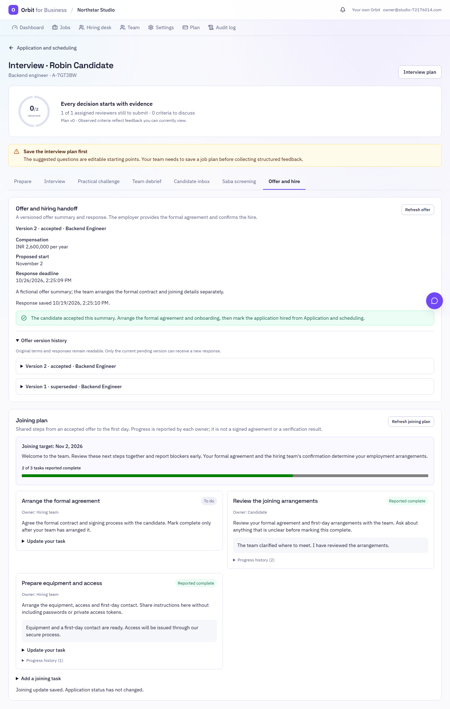
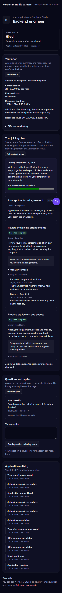

# Joining plans and readable offer history

This follows [the Business candidate cycle](BUSINESS-CANDIDATE-CYCLE.md). It connects an accepted offer or a
human-confirmed hire to the first-day arrangements. It does not provide contracts, e-signatures, identity checks,
payroll or HRIS provisioning.

## Merge repair

PR #410 reached `main` at `17bfc0bd`. PR #411 was subsequently merged into
`business-hiring-operations-2026-10-19` at `7512d700`, after that branch had already been merged.
Consequently `main` did not contain #411's Business Saba, offer or automatic-application implementation.
This review branch carries that original implementation forward, plus the changes described here, with **main
as the PR base**. It does not require another stacked-branch merge or retargeting step.

## Share a joining plan

1. Open an application → Interview workspace → **Offer and hire**.
2. After the candidate accepts an offer summary, or a person moves the application to Hired, review the suggested
   joining tasks. Replace the example instructions with the team's actual arrangements and set the joining target.
3. Choose who reports each task's progress: **Hiring team** or **Candidate**. Optional target dates are calendar
   dates, displayed without a UTC conversion; they are planning information rather than automated overdue verdicts.
4. Share the plan. The candidate receives one email linking to their existing private application page. Exact retries
   preserve the same plan and do not send another notification.
5. Each owner can report complete, explain a blocker, or reopen their own task with a note. The other side can read
   the update and history. Recruiters cannot report candidate-owned tasks complete on the candidate's behalf.
6. Add further tasks when needed. Existing instructions, target dates and the joining target remain as published;
   explain changed arrangements in a dated progress note or add a new task. Previously saved records are not overwritten.

All plan content and progress notes are shared with the candidate. This is not a place for private panel feedback,
identity documents, bank details, passwords or access tokens. Progress is an owner's report, not verification that a
contract was signed or a check passed. No progress action hires or rejects anyone.

The initial plan contains 1–12 tasks and can grow to 20. A plan accepts up to 200 progress updates. These limits are
enforced on the server, including concurrent additions. An application has one plan; its original instructions are
immutable. New tasks are available on the private page; only initial publication sends a notification email.

## Track the handoff

The hiring desk now has a **Joining plans** section, including candidates already marked Hired. It lists progress,
blocker counts, deletion requests and the joining target. Plans are shown newest first, 20 per page, with **Load
older joining plans** for earlier records. This is a paginated list, not a claim that the first page contains every
blocker in the company. Open joining plan links directly to the Offer and hire tab.

Owners, admins and recruiters see their accessible applications; hiring managers see only jobs assigned to them.
Interviewers cannot access this section or joining details. Blind review masks candidate identity in the desk,
plan instructions and progress notes. Public pages use generic Candidate/Hiring team authors without staff identifiers.

Joining updates and questions remain available after a confirmed hire. Rejection, company suspension, an unconfirmed
email or a deletion request pauses joining writes. Existing records remain readable until the application's normal
retention/deletion process removes them. Candidate questions remain blocked on rejected or deletion-pending applications;
personal interview evidence continues to use its existing active-application guards.

## Offer version history and retries

Both sides can open **Offer version history** to read original terms, compensation and saved responses. The list
loads 20 versions at a time. Superseded versions have no accept/decline buttons. Acceptance still applies only to the
current pending version; old, withdrawn or expired versions cannot receive a new response. Staff identity and internal
request keys are not included in public history, and staff text respects blind review.

The offer, Saba and candidate-message forms now associate retry IDs with the actual request body. An unchanged retry
keeps its identity after a network failure. Editing the text or refreshing to a new revision produces a new identity,
so an earlier conflict cannot permanently trap the edited form. Server-side idempotency and stale-write checks remain.

## Data and rollout

- No new migration, dependency or secret. Joining plans use application-scoped BizEvents and the existing deletion cascade.
- Company writes require applicant-management permission and the existing application/job visibility checks.
- Task progress checks the task's current revision under the company write lock. Different simultaneous updates against
  the same revision conflict; identical retries remain safe. New tasks check the plan revision separately.
- Pipeline moves/rejections take the same company lock, so joining and offer writes serialize with status changes.
- The PostgreSQL CI lifecycle gate includes `test_business_handoff.py`. Local coverage also exercises SQLite races,
  pagination with equal timestamps, tenant and role boundaries, owner-only writes, deletion, suspension and email-confirmation guards.
- Browser coverage uses fictional companies and candidates, the real HTTP paths, mobile dark mode and accessibility checks.

The provider limits in the previous release still apply: IPinfo requires configuration, and deepfake/liveness/identity
verification are not implemented. Personal Saba's practice interviewer and voice engine are unchanged.

## Local verification (2026-10-19)

- 1,049 targeted API/security tests pass, covering Business workspace, hiring, operations, studio, candidate cycle,
  joining plans, races and authorization boundaries. The nine new joining/history tests are included in that run.
- All 544 web unit tests pass. Workspace TypeScript checks pass; lint has zero errors and the two existing hook
  warnings in SupportChat and SessionSetup. Ruff, mypy (263 source files) and Bandit pass.
- The production web/SSR build, 150-file prerender and every bundle budget pass without increasing limits.
- Four browser scenarios pass: the Business hiring cycle, joining-plan/offer-history cycle, and both personal Saba
  voice/conversation scenarios. The final mobile ordering adjustment also passes its complete joining scenario.
- PostgreSQL and Docker remain unavailable locally. Hosted CI status is recorded in the review PR; no hosted
  success or live verification-provider acceptance result is implied by these local checks.

Screenshots contain fictional people and employers:

