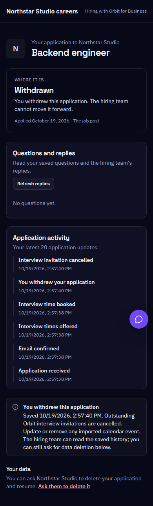
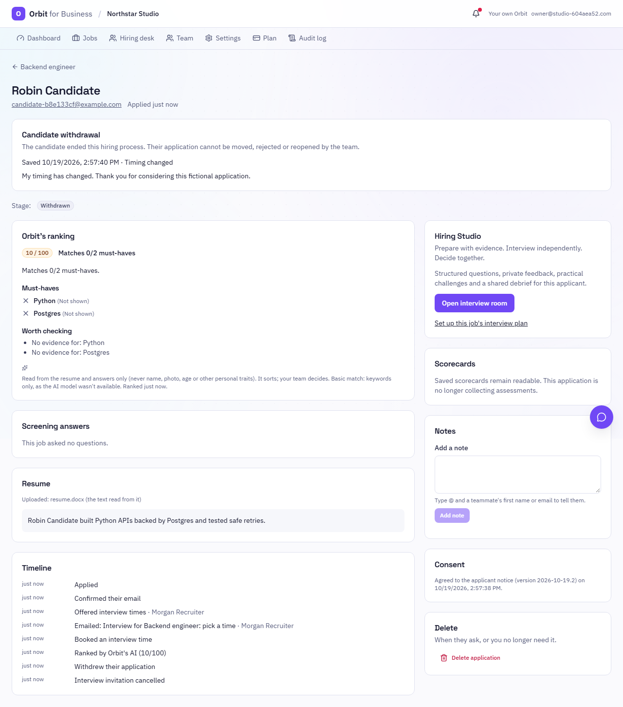

# Candidate-controlled withdrawal

This extends [the candidate cycle](BUSINESS-CANDIDATE-CYCLE.md) and [joining plans](BUSINESS-JOINING-PLANS.md).
It gives candidates a way to stop consideration for one application while keeping the saved record. Personal Saba's
practice interviewer, prompts and voice engine are unchanged.

## Candidate flow

1. Open the private application page and confirm the application email if necessary.
2. Under **Manage this application**, choose **Withdraw from this hiring process**. A reason and note are optional;
   both are shared with the hiring team. No medical, financial or identity documents are requested.
3. Read the withdrawal notice and review the confirmation dialog. Cancelling it does not change the application.
4. Confirm withdrawal. The status becomes **Withdrawn**. The team cannot move it back into hiring or change it into
   an employer rejection. The original stage, assessments, transcript, offer responses and joining history remain.
5. Outstanding Orbit interview invitations are cancelled. For a future booked interview, the cancellation attachment
   retains the original calendar UID with an increased sequence and cancelled status. Update or remove any event
   already imported into another calendar; Orbit does not control external calendars.

Withdrawal is available for confirmed applications still marked active, including when the company is suspended or
a data-deletion request is already pending. Hired or rejected applications cannot be withdrawn through this action.
No automatic reopening or repeat application to the same employer job is provided.

The notice states the retention period recorded when the candidate originally applied. Withdrawal has its own notice
version (`2026-10-19.1`), separate from the original application and agency consent notices. The server checks the
version, application reference and acknowledgement, then saves the accepted notice text alongside the original event.

## Effect on hiring and notifications

- Stage moves, rejection, reopening, interview invitations, new scorecards, email actions, candidate replies and new
  ranking requests are refused after withdrawal. Existing Saba, work-sample, offer and joining write guards also stop
  further submissions. Previously saved material remains readable until normal deletion/retention removes it.
- The employer sees a distinct withdrawal record. Optional reason/note details require applicant-management
  permission; assigned interviewers see the generic withdrawn state. Blind review masks identity in the note.
- Withdrawn applicants are hidden from the default pipeline. **Show withdrawn** reveals their history without drag,
  stage or bulk-selection controls. Job stage counts exclude them, total applicants remain historical, and company
  analytics report withdrawals separately from hires and rejections.
- Accessible current company members receive an in-app notification. Email uses the candidate reference rather than
  their name or note. Current visible members receive the withdrawal update; interviewers receive cancellation email
  only when they belong to the frozen interview panel. Removed members and other companies are not recipients.
- Exact retries preserve one event and one set of notifications. Different content cannot overwrite the withdrawal.
  Company locks serialize withdrawal with hiring decisions, bookings and other application writes.
- Queued rankings skip withdrawn applications. If a provider call is already running, it may finish; the result is
  discarded under the company lock. Actual recorded provider usage can still be attributed without publishing a score.

Notification mail uses the existing post-commit, best-effort sender. A saved withdrawal remains authoritative if email
delivery fails. This change does not add a durable email delivery queue or guarantee that every recipient's calendar
client automatically processes a cancellation attachment.

## Personal Orbit and automatic submissions

For an Orbit Business job submitted through automatic apply, **Applications → submission receipt → Manage employer
application** opens the owned private employer page. The API derives this path at read time only when the packet,
application user and job match. A different user cannot retrieve the packet or obtain its private link. Deleted
applications no longer produce that link. The raw private token is not copied into submission metadata.

The personal tracker gains the **Withdrawn** stage and clears the synchronized follow-up date. Withdrawn entries do
not generate interview/follow-up reminders or a next-step mission. Manually editing a tracker entry alone does not
notify an employer; the UI says to use the actual employer application page to withdraw there.

The original submission receipt stays submitted and keeps its original quota charge. Withdrawal does not pause the
candidate's campaign, refund an application already submitted, cancel other applications or change saved offer
responses/formal agreements. Supported external ATS applications still need the employer's own withdrawal process.

## Data and rollout

- No migration, dependency or secret is added. `withdrawn` fits the existing application status column. The event,
  notifications and cancellation record use the existing application deletion cascade.
- Withdrawal is separate from a deletion request. Its original retention period is measured from withdrawal;
  requested deletions still follow the existing 30-day process. Historical hired/rejected policies are unchanged.
- Deploy the matching API and web types together; web support for the new tracker value should be available before
  the API starts returning it. Refresh older open web sessions after rollout. The default apply notice and personal
  agency consent version are unchanged.
- The new test module is included in the PostgreSQL CI lifecycle gate. Tests use fictional applicants, local outboxes
  and recorded providers. They cover cancellation files, role/tenant boundaries, stable retries, competing hire and
  withdrawal requests, status-link ownership, retention and ranking already in flight.

The existing provider limits remain: no deepfake, liveness or face/document verification is added by this release.

## Local verification (2026-10-19)

- A 1,171-test API/security regression run passes across Business hiring, studio, operations, handoff, candidate cycle,
  workspace, races, authorization, tracker and auto-apply modules. After the final guards, the 48 affected hiring and
  withdrawal tests pass. The final expanded withdrawal module passes all 11 tests, including in-flight ranking.
- All 545 web tests pass. Workspace TypeScript checks, Ruff, mypy (264 source files) and Bandit pass. Lint has zero
  errors and two existing hook warnings in SupportChat and SessionSetup.
- Production web/SSR build, 150-file prerender and all bundle budgets pass without increasing limits.
- The complete five-scenario browser rerun passes: Business hiring, joining plans, withdrawal, and both personal Saba
  voice/conversation scenarios. An earlier voice probe was interrupted by a dev-page navigation; it passes unchanged
  in the final complete rerun. Further withdrawal checks cover tablet/phone tracker layout and absence of stale controls.
- PostgreSQL and Docker are unavailable locally. The PostgreSQL lifecycle gate includes the new module; hosted CI
  results and any account-level blockage are recorded in the review PR.

Screenshots use fictional companies and candidates:

