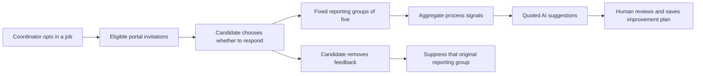

# Candidate Experience Hub

Business → Candidate experience adds a process-feedback loop beside the hiring pipeline. A pipeline action
opens its job directly. The job picker lists up to 200 visible jobs; an authorized older job can still be opened
from its pipeline link. Interviewers cannot use this workspace; owners/admins/recruiters and assigned hiring
managers follow the existing `move_applicants` permission and job visibility rules.

## Campaign and invitation workflow

Campaigns default off. A coordinator chooses eligible stages (interview, offer, hired, rejected or withdrawn)
and an invitation lifetime of 1–30 days. Enabling a campaign does not send an email. Eligible confirmed
applications receive a prompt inside their existing private application portal.

**Prepare opted-in invitations** reconciles up to 100 new eligible applications in the selected job. The
existing Business automation loop also reconciles enabled campaigns after 30 seconds and then about every
five minutes while the API runs. Company transaction locks and the application-keyed invitation table prevent
duplicates across retries/replicas. Each application gets at most one invitation for its lifetime. Moving stages,
changing settings or re-enabling a campaign does not reset participation or repeatedly invite someone.

Unconfirmed and deletion-pending applications are not enrolled. Turning off a campaign pauses new invitations
and new responses; candidates can still read/download their own submitted feedback and remove it. Suspended
companies do not enroll or accept new responses. Existing consent/withdrawal/deletion controls remain available.
Campaign expiry changes apply to newly prepared invitations, not old invitation deadlines.

## Candidate choices

The private application portal shows the fixed, versioned short survey only when an invitation exists. It
collects 1–5 agreement ratings for useful communication, clear next steps/expectations and respect for time,
plus an optional categorical improvement priority. There is no free-text, demographic or protected-attribute
field. The candidate reads the notice and explicitly chooses to submit; no default answer/consent is selected.

Candidates can decline without sharing ratings, download their own submitted feedback or remove it later,
including after expiry/campaign disablement/company suspension. A submitted/declined/removed invitation cannot
be reused. Ratings cannot be edited after submission; this avoids changing already released groups one person
at a time. HTTP retries with the same request UUID and exact input are idempotent. Invalid numbers, coerced
string/boolean ratings, extra fields and a stale/unconfirmed notice are rejected.

The notice explains that this is **not anonymous**: responses are linked to the application for withdrawal and
deletion. Staff have no individual response view, but the private application link still authorizes candidate
controls. Feedback does not change application stage, scores, offers, assessments or hiring decisions. Withdrawing
from hiring is separate from removing feedback; candidates can choose either. The normal application deletion
path removes the linked invitation/response by cascade.

## Fixed groups and reports

Reports expose only complete non-overlapping groups of five eligible responses. Partial-group counts, respondent
IDs, names, emails, tokens and individual ratings/timestamps are not available in recruiter reports or exports.
Group membership is assigned once under the company lock; it never changes or recycles after a release.

| Eligible submissions | Staff-visible result |
| --- | --- |
| 1–4 | Withheld; no response count or scores |
| 5 | First group of five released |
| 6–9 | Same released group; pending responses do not change the report/version |
| 10 | Two groups, ten released responses |
| One member of the first group removes feedback | Entire first group withheld; the other group remains five |
| Four remaining members of a suppressed group | Never recycled into another reporting group |

A withdrawal, application deletion/deletion request, unconfirmed address or expired response invalidates its
whole original group. Pending responses do not affect the public report fingerprint. This reduces one-response
differencing and small-cohort exposure; it is not a guarantee against inference when people know others'
answers. Already downloaded/viewed historical aggregates cannot be recalled. There are no arbitrary stage,
date, demographic or individual-response filters/exports.

For released groups, coordinators see means, 1–5 distributions and categorical improvement totals. These are
voluntary process ratings, not external benchmarks, causal explanations, discrimination diagnoses or candidate
suitability scores. Declining/withdrawing feedback is not exposed on the recruiter application timeline.

Raw responses stop contributing after 90 days. Scheduled cleanup deletes expired raw answers, including when
campaigns/companies are disabled; it runs while the API is operating. Minimal invitation/participation metadata
remains with the application to prevent repeated invitations/submissions and follows application deletion.
Report batches retain only job/group metadata after answers disappear. The candidate page discloses the
contribution window and cleanup behavior. Application data retention is otherwise unchanged.

## AI and reviewed improvement plans

The AI brief receives only released aggregate facts (means/distributions and improvement-category totals).
It receives no individual responses, application identity, resumes, scorecards, conversations or plan text.
Every accepted tip must quote a supplied aggregate exactly and include a practical suggestion/check. Quoting
validates attribution, not the correctness of a proposed experiment.

Ten experience-brief attempts per company per UTC day are reserved durably, including provider/validation
failures. At least one full released group is required. Permissions, job visibility and the report version are
checked before and after generation; withdrawals/settings/plan changes can reject stale advice. AI uses no
tools and cannot contact candidates, save a plan or change a hiring record.

**Use AI suggestions in plan** copies suggestions into a local editable draft only. A human reviews the goal,
up to five bounded actions, progress (planned/in progress/completed) and review date, then explicitly saves.
Using AI suggestions requires a current source version on save. If the report changes, unsaved plan text stays
available for download and the coordinator can review the updated report before rebinding its reference.
Manual plans are also allowed without AI or a released report. Plans and settings use optimistic revisions;
stale writes fail instead of silently overwriting another coordinator's work. Staff-authored plan text should
be reviewed before export; the aggregate pipeline does not automatically insert candidate identities into it.

## API and persistence

Staff prefix: `/v1/business/companies/{company_id}/experience`.

| Endpoint | Result/action |
| --- | --- |
| `GET /` | Visible job picker metadata, capped at 200 |
| `GET /{job_id}` | Campaign, aggregate report, source facts, version and team plan |
| `PUT /{job_id}/settings` | Explicit opt-in/stages/expiry with base revision |
| `POST /{job_id}/invitations/run` | Idempotent eligible enrollment, at most 100 new invitations |
| `POST /{job_id}/brief` | Read-only source-quoted aggregate advice |
| `PUT /{job_id}/plan` | Explicit human plan save with revision/optional source version |

Candidate prefix: `/v1/public/business/applications/{private_token}/experience`.

- `GET` reads that candidate's notice/invitation/response only.
- `POST` submits strict ratings, category, explicit notice confirmation and request UUID.
- `DELETE` declines the unsubmitted invitation or removes that candidate's response.

Candidate writes revalidate the token/application/company after waiting for the company lock. No staff endpoint
returns raw answers. Four new Business tables hold campaigns/plans, application invitations, reporting-group
metadata and private responses. Existing application status gains a boolean indicating whether an invitation
exists; it does not expose whether that person responded. Staff configuration/plan actions are audited, but
individual candidate feedback submission/withdrawal is not added to hiring timelines/audits as a response signal.

## Rollout and verification

Migration `c9e3f5a7b2d4`, parent `b8d2f4a6c1e3`, creates the four tables and indexes. It does not enable campaigns,
prepare invitations or alter existing applications. Apply migration before deploying the API: application
status now checks invitation existence. Response foreign keys cascade with invitation/application/job deletion;
the retention timestamp is indexed. Upgrade/downgrade tests preserve existing jobs/applications. No production
migration/deployment or external survey sending was performed in this task.

The release is Business-only, including the company application portal. It adds no provider credentials,
subscriptions, third-party runtime dependencies, survey emails, model downloads or Orbit Personal changes.
The background loop reuses the existing scheduler and isolates failures from other Business automations.

Tests exercise default-off/stage enrollment, exact notice/type checks, fixed group release, hidden partial
groups, concurrency/idempotency, decline, withdrawals, deletion/retention, company/job/role/token boundaries,
AI source/permission freshness, quotas, reviewed plans and migration roundtrips. Chromium covers five real
application flows, the fifth response releasing aggregates, AI-to-plan review, self/aggregate downloads,
withdrawal suppression, unchanged application states, mobile overflow and automated accessibility checks.
AI uses mocks; live-provider usefulness and high-volume deployment behavior were not certified.
