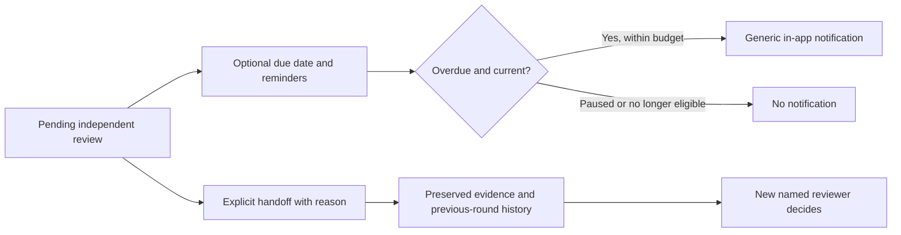

# Review follow-ups and handoffs

Workflow review checkpoints now have optional due dates, bounded in-app reminders, personal reminder pauses and
an explicit handoff to another independent reviewer. These controls support coordination; a deadline never
approves, rejects or expires a checkpoint, and no external message is sent by the reminder worker.

## Product flow

After requesting a checkpoint review, open **Follow-ups and reviewer handoff** in its run.

- The requester, checkpoint owner or workspace owner/admin can set a UTC due date and enable internal overdue
  reminders. Existing requests and new requests default to reminders off. A due date can record an already-late
  review, or be up to 365 days ahead; a date is required while reminders are enabled.
- The named independent reviewer can pause their own reminders until a UTC date within the next 30 days, or resume
  them. The due date and decision responsibility stay unchanged. The reminder budget never resets on pause/resume.
- An authorized requester/owner/admin can hand a pending review to another current coordinator, with a reason.
  The original pending request is invalidated for execution and retained in history. A new request retains the
  same evidence hash/snapshot, due date and reminder budget/cooldown. The prior reviewer's personal pause is not
  transferred. The new reviewer must review the evidence and make their own decision.
- The checkpoint owner, current handoff actor and everyone who requested that handoff chain remain ineligible to
  review it. The current reviewer cannot be selected as their own replacement. Handoffs consume the existing
  maximum of 20 review rounds per checkpoint, and exact UUID retries do not create extra rounds.
- The review inbox can show all pending, overdue or personally paused requests. Dated requests sort earliest due
  first, followed by undated requests, with stable creation-time/ID ordering. Scope is checked before the 50-item cap.

## Reminder semantics

The existing Business automation loop scans about every five minutes after startup. Owners/admins can also use
**Check due review reminders** in the inbox. The manual scan obeys exactly the same eligibility, cooldown and
budget checks; repeatedly clicking it cannot bypass those limits.

A review becomes overdue at 00:00 UTC on the day after its due date. Notifications are eligible at that instant,
three days later and seven days later, with **at least 24 hours between actual sends** and **at most three per
review chain**. If the API was offline for days, it sends at most one reminder per eligible scan/cooldown, not a
burst of all missed reminders. Scheduler delays mean this is not a guaranteed delivery SLA.

Every scan takes the company lock and rechecks company state, active run, current review pointer, unchanged
checkpoint evidence, reviewer eligibility and independence, requester existence, pause, cooldown and count.
The notification and durable count/timestamp commit together. An interrupted transaction rolls both back;
concurrent scans cannot both consume the same reminder slot. Reminder delivery metadata does not change the
run's action revision; explicit settings, pauses and handoffs do.

Notifications use the existing Business notification list, with a generic message and a link to the personal
review inbox. They contain no evidence notes, candidate data, job titles or private application links. Old
notifications are historical messages and are not recalled after a handoff; the linked inbox always checks
current access. No email, Slack, SMS or push provider is installed or invoked.

Snoozing, toggling reminders, editing a due date and handing off do not refill the budget. A new evidence review
round after changes requested has its own budget; it defaults off and needs explicit configuration. Completed,
withdrawn, superseded, invalidated, cancelled, suspended or inaccessible reviews are not reminder candidates.
A removed reviewer must be replaced explicitly; automation does not choose a substitute.

## AI and data boundaries

The existing AI progress brief now receives aggregate overdue-review and paused-reminder counts alongside
checkpoint totals. Identities, evidence, due-date details, handoff reasons and personal preferences are not sent.
AI does not configure reminders, reassign reviewers or record decisions. Source quotes, company quotas and
post-generation access/version checks remain in force; testing uses mock providers rather than live models.

Migration `b5d9e1f3a7c0` follows `a4c8d0e2f6b9`. It adds due date, reminder enablement/count/timestamp, pause,
previous-round ID and handoff-reason columns, plus a reminder-scan index. Legacy rows retain their decisions and
start with delivery off and zero sends. Previous-round IDs are same-run provenance written by the service, not
editable user-supplied links. Review data still follows run/job deletion; this is not a separate retention system.

## API additions

Root: `/v1/business/companies/{company_id}/workflow-studio`

| Method/path | Purpose |
| --- | --- |
| GET /review-inbox/mine?view=all\|overdue\|snoozed | Named reviewer's current, scoped queue |
| POST /review-inbox/reminders/run | Owner/admin checks this company's eligible internal reminders |
| POST /{job}/runs/{run}/steps/{step}/reviews/{review}/followup | Configure due date and reminder enablement |
| POST /{job}/runs/{run}/steps/{step}/reviews/{review}/snooze | Named reviewer pauses/resumes their own reminders |
| POST /{job}/runs/{run}/steps/{step}/reviews/{review}/handoff | Authorized, idempotent new reviewer round |

Mutations recheck access under the company lock and require the current run revision. Handoffs additionally
bind a request UUID to the original review and submitted payload. A stale/closed review cannot be reconfigured
or handed off. The existing human decision endpoint still requires its named reviewer, evidence hash, explicit
acknowledgement and current run revision.

## Verification and rollout

Tests cover UTC thresholds, cooldowns and budgets, pausing/resuming, disabled-overdue settings, handoff identity,
idempotency, historical evidence, stale/inaccessible reviews, scoped filters, concurrent scans and transactional
rollback. A migration roundtrip preserves legacy decisions and safe defaults. The API security route matrix runs
with the new protected endpoints. CI selects the feature tests for Postgres; local tests use SQLite.

The browser flow uses separate requester, initial-reviewer, replacement-reviewer and test-admin contexts. It
checks actual internal notification creation, a personal pause, filtered inbox, explicit handoff, retained evidence,
independent approval and unchanged job status, plus mobile dark-mode WCAG/overflow checks. Test email goes only
to the local dev outbox for account verification and team invitations. Production migrations are left to the normal
release process; this work does not run one manually.

See [the source comparison and next gaps](BUSINESS_REVIEW_FOLLOWUP_RESEARCH.md).
