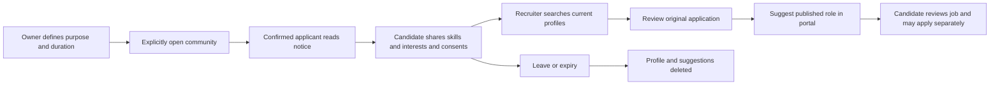

# Business Talent Communities

A voluntary future-opportunity workflow linked to a candidate's existing Business application. It does not
reuse Orbit Personal profiles, infer consent from applying, or turn experience feedback into a recruiting signal.

## Workflow

In Business, open **Talent communities**. Owner/admin can create up to 25 communities and change settings.
Communities default off; configure a name, a clear 20–1,200 character purpose and 30–365 day consent period.
Recruiters can discover profiles and manage suggestions, but cannot change consent terms. Assigned-only hiring
managers and interviewers have no pool directory access.

Confirmed applicants see open communities under **Future opportunities** in their private application portal.
They choose 1–12 distinct skills, describe interests and check an unchecked notice acknowledgement. Membership
is separate for every application and community; no cross-application or cross-company identity merge occurs.

Recruiters search literal candidate-provided skills/interests. Search does not inspect names, resumes, assessment
scores, experience ratings or protected characteristics. `%` and `_` are literal search text, not wildcard queries.
Results are ordered by member ID and paginated 50 at a time; there is no suitability ranking.

After reviewing the original application, recruiters explicitly suggest a published, available job in the same
company. Each membership has at most 20 unique role suggestions. Suggestions are idempotent for a member/job;
they appear only inside the private candidate portal. Candidates can dismiss them, review the public job, and
choose whether to make a separate application. A suggestion creates no application, decision or email.

## Consent and removal

- Consent saves the notice version, notice+terms SHA-256, current terms revision, timestamp and expiry.
  The candidate can download their community data and notice information.
- A retry of the latest unchanged consent request does not extend its expiry. Reusing that UUID with changed
  details returns 409. Explicit renewal uses a fresh request ID and clears old role suggestions. This is
  last-request retry protection, not an unlimited historical idempotency ledger.
- Pausing a community hides its directory and suggestions and prevents joins. Existing expiry dates do not move.
  Reopening resumes only memberships whose consent is still current.
- Changing name, purpose or duration increments the terms revision and deletes all associated profiles and
  suggestions immediately; applicants must choose to join again. The UI requires a terms-change acknowledgement.
- Expired consent is hidden at query time, even if the sweeper is delayed. Cleanup runs with Business automations
  about every five minutes after startup, serializes by company, and deletes expired memberships and suggestions.
- Candidate withdrawal deletes the membership and cascades its suggestions immediately. Withdrawal and
  suggestion dismissal remain possible when the community is paused, company suspended or application deletion
  pending. Email confirmation and a valid private application token are still required.
- Pending application deletion hides profiles before the existing retention/deletion worker removes the application.
  Deleting the application or its job cascades memberships and suggestions. Community consent never extends
  application retention; withdrawing an application from hiring does not itself revoke separate community consent.
- A suspended company cannot discover profiles or receive fresh consent. Candidate suggestions also require a
  verified company, open role and no role takedown. Closed/paused/taken-down roles disappear from candidate results.
- Revocation is enforced on new API requests; it cannot recall information already viewed or downloaded.

Community settings and role suggestion events enter the existing audit log without copying candidate names,
skills, interests, emails or private link tokens. Consent/profile records are removable operational data, not an
immutable audit stream. Protect the private application link as a bearer credential.

## API and storage

Staff root: `/v1/business/companies/{company_id}/talent`

| Method/path | Purpose |
| --- | --- |
| GET /, POST / | List / create communities |
| PUT /{pool}, DELETE /{pool} | Optimistic revision update / delete community and its memberships |
| GET /{pool}/members?q=&after= | Current profiles; literal skills/interests query, 50-row cursor pages |
| GET, POST /{pool}/members/{member}/suggestions | Review / explicitly suggest a job |
| DELETE /{pool}/members/{member}/suggestions/{suggestion} | Remove a suggestion |

Candidate root: `/v1/public/business/applications/{token}/talent`

| Method/path | Purpose |
| --- | --- |
| GET / | Current communities, own consent/profile and available role suggestions |
| PUT /{pool} | Explicit consent / renewal with current notice version and terms revision |
| DELETE /{pool} | Leave; idempotent removal |
| DELETE /{pool}/suggestions/{job} | Dismiss only this applicant's role suggestion |

`biz_talent_pools`, `biz_talent_members` and `biz_talent_suggestions` are introduced by migration
`d0f4a6b8c3e5`, following `c9e3f5a7b2d4`. Unique constraints prevent duplicate membership and member/job suggestions.
Foreign keys cascade the deletion paths. There are no copied resumes, embeddings or external delivery jobs.
All writes use the company lock and revalidate current access after acquiring it, including the private token
on candidate writes. Settings updates require the current revision. A renewed consent is never shortened or
extended by an old expiry cleanup decision: cleanup tests expiry again under that same company lock.

## Verification and rollout

API coverage includes consent validation, retry conflicts, current-only search, literal wildcard escaping,
permissions, company isolation, suspended/paused/deletion cases, expiry, pagination, suggestion idempotency,
role closure, candidate dismissal and deletion cascades. The migration roundtrips twice against existing job/
application data and verifies pool/application cascades. Combined upgrade checks include the previous released
experience revision. The API feature suite is included in the Postgres CI selection.

The browser spec creates a verified test company and application with a dev outbox, then exercises community
creation, candidate consent, recruiter search, public role navigation, self-download and withdrawal; it checks
mobile dark mode, reduced motion, overflow and WCAG A/AA findings. No live AI, real outbound messages or provider
integrations are exercised. Apply the reviewed migration using the normal release process before enabling the
new routes in production. This code change does not execute a production migration or deployment.

See [the research decision and remaining gaps](BUSINESS_TALENT_RESEARCH.md).
