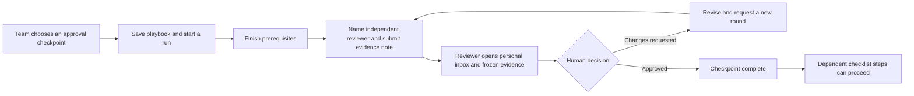

# Independent workflow checkpoints

Business Workflow Studio now supports optional, human-reviewed approval checkpoints in a saved playbook.
An approval concerns a frozen internal checklist record. It does not approve a budget, publish a job, select a
candidate, send a message, or verify the truth of a coordinator's notes.

## Workflow

Choose **Independent launch review** in Workflow Studio, or check **Require an independent review decision**
while editing a step. This affects future runs of the saved definition. Existing runs retain their original
steps, including whether a checkpoint requires approval. Checkpoint policy is opt-in at the playbook level,
not a mandatory company publishing policy. AI drafts are forbidden from enabling approval flags.

After prerequisites are done, a coordinator names a current reviewer and supplies a 20–1,200 character evidence
note. The reviewer must be different from both the requester and the checkpoint owner. This is independence
from those two roles; it does not exclude everyone who contributed to earlier prerequisites. A team with only
one eligible coordinator needs another member before using the checkpoint.

The evidence snapshot records the frozen playbook/checkpoint definition, original plan revision and start date,
checkpoint owner, and all transitive prerequisite records (state, owner, last note and completion identity/time).
It is hashed on the server. This hash binds the decision to the captured record; it is not a digital signature,
identity verification or legal e-signature.

**Review inbox** lists the named reviewer's pending requests across jobs they currently access, ordered by due date before undated requests,
up to 50 at a time. Open a request to enter its exact run. The reviewer opens the evidence/history, writes a
decision note, acknowledges the snapshot, then approves or requests changes. Only that named, currently eligible
reviewer can decide. Clicking ordinary step completion cannot complete an approval checkpoint.

## Evidence, history and correction

- A pending or approved downstream review freezes edits to its prerequisite records. Withdraw a pending review,
  or reopen an approved checkpoint, before changing that evidence. This includes owner/note edits as well as
  reopening completed prerequisites.
- A pending checkpoint's owner cannot be changed in place. Withdraw first, then assign and request again.
  The requester, checkpoint owner or workspace owner/admin can withdraw; another recruiter cannot impersonate them.
- Changes requested leaves the checkpoint unfinished. A new request records a new snapshot and decision round;
  the earlier snapshot and response remain visible. There are at most 20 rounds per checkpoint per run.
- Approved decisions cannot be overwritten. Reopening the checkpoint marks its earlier approval invalidated
  for current execution but preserves its original decision, response and evidence. Reopen completed downstream
  checkpoints first where necessary.
- Cancelling a run invalidates its pending requests and removes them from inboxes. Completed/cancelled run deletion
  and job deletion cascade review evidence. Review records otherwise follow the run lifetime, not a separate
  immutable evidence-retention service. Company audit metadata remains under the existing audit policy.
- Loss of reviewer access prevents new decisions and removes inaccessible jobs from their inbox. The requester or
  administrator can withdraw and select another current coordinator. Past approvals remain historical records
  after later access changes; eligibility was checked when deciding. Deleted account references become null.
- Every mutation takes the company lock, refreshes role/job access and checks the run revision. Concurrent
  approve/request-changes calls cannot both succeed. A request UUID/fingerprint protects exact request retries;
  conflicting reuse is refused. Keys are not permanent after explicit deletion of the containing run.
- The snapshot covers the run evidence, not live external documents or subsequent job edits. A changed job brief
  does not silently rewrite the frozen run approval. Review in the actual hiring workspace before acting there.

Evidence notes are private to current authorized coordinators for that job. Keep candidate details out. The
history can be downloaded locally. Snapshot data is displayed as text; no arbitrary URL, script or tool runs.

## AI and visual integration

Workflow progress briefs now include aggregate checkpoint/pending/changes-requested counts when applicable.
Evidence notes, snapshot contents, requester/reviewer identities and decision notes are not sent to the model.
AI cannot enable approval policy, record a review decision or bypass the human endpoint. The existing quota,
source-quote validation and stale-version checks apply; no new live-model evaluation was performed.

The editor shows an explicit checkpoint switch. Runs display review status and a checkpoint summary; the inbox
has accessible cards and direct links to each run. Existing vector graphics and reduced-motion behavior remain.
The evidence panel has labeled fields, an acknowledgement checkbox, textual decision state and a local download.

## API and data

Existing root: `/v1/business/companies/{company_id}/workflow-studio`

| Method/path | Behavior |
| --- | --- |
| GET /review-inbox/mine | Current named reviewer's oldest 50 visible pending requests |
| POST /{job}/runs/{run}/steps/{step}/reviews | Request a checkpoint review, with UUID, run revision, reviewer and note |
| GET /{job}/runs/{run}/steps/{step}/reviews | Up to 20 evidence/decision rounds for that checkpoint |
| POST /{job}/runs/{run}/steps/{step}/reviews/{review}/decision | Named reviewer records decision, note, evidence hash and acknowledgement |
| POST /{job}/runs/{run}/steps/{step}/reviews/{review}/withdraw | Authorized withdrawal with revision and reason |

Migration `a4c8d0e2f6b9` follows `f2b6c8d0e5a7`, adding `biz_workflow_reviews` and a company/reviewer/status/time
index. Existing JSON plans default to `approval=false`; legacy runs do not acquire gates. The run's current
checkpoint pointer selects the active round, while previous decision/evidence rows remain until run deletion.
Decision status/note fields are not editable through a general-purpose update endpoint. Invalidation metadata
can be added when reopening or cancelling; the original approved decision is preserved.

Tests cover independent identity, acknowledgement and hash binding, revision/concurrency conflicts, review
round caps, access loss, inbox scoping, history preservation, prerequisite freezing, reopen/withdraw/cancel,
AI policy rejection and aggregate-only prompts, schema roundtrips and deletion cascades. Browser coverage uses
two independently authenticated test users with a local dev outbox: request, changes requested, resubmit,
review evidence/download, approve, and confirm that job state remains unchanged. Mobile dark-mode axe and
reduced-motion checks cover both inbox and evidence UI. Postgres feature coverage is included in CI; local tests
use SQLite. Apply the migration with the normal release process; this work does not run production migrations.

See [the targeted research](BUSINESS_WORKFLOW_REVIEW_RESEARCH.md).

The [follow-up extension](BUSINESS_REVIEW_FOLLOWUPS.md) adds explicit due dates, optional internal reminders,
personal pauses and a new-reviewer handoff that preserves the evidence and prior-round history.
