# Business Workflow Studio

Workflow Studio connects role preparation tasks across existing Business workspaces. It is separate from the
applicant-level automation queue: runs are internal team checklists, not application stages or autonomous tools.

## Product flow

```mermaid
flowchart LR
    A[Choose a role] --> B[Template or cited AI draft]
    B --> C[Review local steps and dependencies]
    C --> D[Save playbook revision]
    D --> E[Explicitly start a run]
    E --> F[Assign current coordinators]
    F --> G[Complete prerequisites with notes]
    G --> H[Review progress or AI aggregate brief]
    H --> I[Complete, cancel or correct the run]
```

Open **Workflow Studio** in the Business navigation. Owners, admins, recruiters and assigned hiring managers
can use it for jobs they currently access. Interviewers cannot access the studio. Company/account suspension,
membership changes and job-team removal are checked by the existing access layer; writes refresh those checks
under the company lock.

Three templates provide a starting point. Selecting a template or using an AI draft changes the local editor;
**Save playbook** is a separate action. Step titles, instructions, day offsets, prerequisites and linked
workspaces are editable. Deleting a local step removes its references from later local steps. Download a draft
before refreshing if preserving unsaved edits matters. Changed saved role facts require reviewing the current
requirements before updating the editor's source reference.

A saved playbook is limited to 12 steps. Every identifier is unique. Prerequisites must refer to distinct earlier
steps; cycles, forward references and due dates earlier than prerequisites are rejected. Each step links to one
of five server-owned Business workspaces: pipeline, interview plan, hiring desk, capacity or candidate experience.
Arbitrary URLs, scripts, webhook targets and owner IDs from AI output are not accepted by the plan schema.

## Execution and ownership

- Explicit starts use a UUID request key and fingerprint of the initial inputs. Retries return the same run;
  reusing a key for different inputs returns 409. Existing runs keep their plan content and plan revision.
- The start date is a canonical ISO date and due dates use UTC calendar days plus 0–60 days. Dates that would
  overflow the due-date range are rejected. These are elapsed calendar days, not business-day SLAs.
- One current coordinator may own each step. Suspended users, interviewers and unassigned hiring managers are
  not eligible owners. If access later changes, the run flags that owner as no longer current and counts the
  unfinished step as unassigned. Completion does not require an owner; the acting coordinator is recorded.
- An unfinished step is blocked until all its prerequisites are complete. Completing, reopening and assigning
  require a 3–300 character note and the current run revision. Do not put candidate details in notes.
- Reopening a prerequisite is refused while a direct dependent is complete; unwind completed downstream steps
  first. Completing every step marks the run completed; reopening a completed leaf makes it active again.
- Cancellation freezes edits. Owners/admins can delete completed or cancelled runs. There are at most 20 active
  and 100 total runs per job. Reusing a start key after its run has been explicitly deleted can create a new run;
  the UUID is not a permanent tombstone or external exactly-once guarantee.
- Closed or taken-down jobs cannot start new runs. Existing run records remain available for review/correction.
  Job deletion cascades its plan and runs. Records otherwise follow the job lifetime unless removed by an admin.

Checklist actions do not publish jobs, send messages, alter applications, choose candidates or prove that the
linked work was done. Use the linked workspace to perform that work. Readiness and overdue counts describe the
checklist; they are not candidate scores or employee performance ratings.

## AI boundaries

**Draft playbook** sends the saved role title and at most six bounded must-have requirements. Every generated
step must cite an exact substring of a supplied fact. The graph and all field limits are validated. Citations
are displayed with the proposed draft; manually edited saved plans are team-authored operational records,
not an immutable AI citation ledger. Updating the job/team/plan during generation invalidates the response.

**Progress brief** sends only aggregate total/done/ready/blocked/overdue/unassigned facts. Candidate data,
step instructions, task notes, identities and owner IDs are not included. Responses must quote the facts;
stale run/context changes are rejected, and the UI displays a brief only for its matching version.

Each feature has 10 attempts per company per UTC day, including failures. Existing `workflow_ai.preview`
reserves quota durably before provider I/O and releases locks during generation. It uses the configured LLM
provider; test runs use mocks. No new provider, research tool, mailbox or external workflow runtime is installed.
No live-model quality claim follows from these tests.

## Design and accessibility

The interface uses a custom vector process illustration, dependency map, template icons and a progress bar.
Forms and step lists provide the full textual equivalent of the graph. Keyboard users can select/edit steps,
choose prerequisites, update owners and record completion without dragging. Text describes status in addition
to color. Hover/progress transitions use `motion-safe` and the template transform is disabled for reduced motion.
The mobile layout wraps controls and preserves unsaved notes in other steps when one step changes.

## API and data

Root: `/v1/business/companies/{company_id}/workflow-studio`

| Method/path | Behavior |
| --- | --- |
| GET / | Up to 200 visible jobs and the three templates |
| GET /{job} | Current plan, requirements, eligible owners and up to 100 runs |
| PUT /{job}/plan | Save with base revision and current role-reference version |
| POST /{job}/draft | Cited AI draft; no save |
| POST /{job}/runs | Explicit idempotent start from saved revision |
| GET /{job}/runs/{run} | Progress, step state, ownership and server-owned links |
| POST /{job}/runs/{run}/steps/{step} | Complete/reopen/assign with note and revision |
| POST /{job}/runs/{run}/brief | Aggregate AI advice |
| POST /{job}/runs/{run}/cancel | Freeze the run at the checked revision |
| DELETE /{job}/runs/{run} | Owner/admin removes a closed run |

Migration `f2b6c8d0e5a7` adds `biz_workflow_plans` and `biz_workflow_runs` after merge point `e1a5b7c9d4f6`.
The merge point joins the already-published talent-consent and Business event-kind-width migrations without
changing either migration's parent. Run plan snapshots and mutable step state are JSON; revisions guard
concurrent edits. Company audit events record starts, plan revisions, step actions, cancellation and deletion
without copying task notes or instructions. Current step state records the latest completion actor/time and note;
it is not a full append-only per-step history.

Validation covers graph/date contracts, permissions/job scope, ownership revocation, stale writes, start retries
and concurrency, dependency completion/reopening, cancellation/deletion, caps, migration roundtrips/cascades,
AI grounding/staleness, aggregate-only prompts and quotas. The browser flow covers local AI review, saving,
prerequisite gating, note preservation, progress/brief/download, mobile dark mode, reduced motion and axe checks.
Postgres feature tests are included in CI; no production migration or deployment is executed by this change.

See [research and the remaining roadmap](BUSINESS_WORKFLOW_RESEARCH.md).
