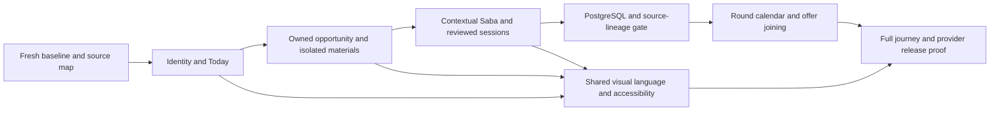

# Unified candidate journey — architecture and delivery

2026-10-21, base `e1426076` (PR444 merged). Active repository takes precedence; no ZIP archive was supplied for this run. The latest detailed owner prompt explicitly authorizes tests and supersedes the former no-tests instruction. No `[skip ci]` on new commits. No production deployment or real external sends authorized.

## State authority decisions (engineering decisions, not fabricated owner sign-offs)

- Resume content/version: existing Resume and its optimistic concurrency contract. Existing snapshots and packets retain their own immutable data. New job linkage must make independent copies when the selected resume is a master or is shared by another job.
- Explicit master and review: nullable `JobSearchProfile.career_identity` stores only owned resume identity, revision/fingerprint and review time. Resume remains the facts authority. The existing `resume_id` remains the search-specific selection; changing search preferences cannot redefine the master. No silent newest-resume promotion, no imported-fact approval backfill.
- Opportunity: existing owned JobApplication. Keep `/jobs/mission/:entryId` and safe query keys. No second tracker or packet engine.
- Session/round: LiveSessionRow.application_id is the explicit job reference. Company-name similarity is not a confirmed association; this slice separates possible history from linked progress and adds reviewed associations of ended owned sessions. In-progress sessions remain visible events but do not count as completed practice.
- Next action: existing action queue and `action_priority.priority`, followed by explicit identity/profile gaps and existing opportunity records. Models may explain grounded actions, never assign stages/deadlines.
- Navigation: retain Today / Discover / Applications / Prepare / My Career. The ephemeral return trail is navigation only. Progressive sections should replace guided/expert duplication without deleting specialist routes.

## Independently reviewable phases

0. Fresh baseline and classified inventory. Repair demonstrated regressions; retain failing evidence. Separate harness collisions, fixture prerequisites and actual application defects.
1. Explicit candidate identity + Today/My Career/Discover. Version-bound review, independent master copies, source-backed next action and calm primary layouts. Additive migration `e62f8d0b351c`; no destructive backfill. Backend first, then clients. Legacy profile references are not automatically approved.
2. One stable Opportunity Room. Reuse existing panels and kit statuses; eliminate guided/expert presentation split, keep deep-link aliases; protect master/job independence and edited drafts.
3. Context-bound Saba and reviewed session linkage. Preserve mock/real distinction, permission fallback, billing and provider fences. Expose linked reports without attributing company-name matches as fact.
4. Real round/timezone/offer continuity. Add schema only for missing authority; preserve completed preparation and export/delete. No tax/provider assertions without evidence.
5. Apply shared visual language alongside each phase. Actual before/after captures, small/mobile/desktop layouts, dark/light, Full/Off and keyboard/zoom.
6. Valuable additions only after integration; no speculative orchestration or dependency replacement.
7. Fresh integration suites and factual release scorecard. No GO while required local/operator evidence is absent.

## Verification and rollback

Run targeted API ownership/concurrency/source/lineage and frontend action/navigation tests per patch; fresh full API/workspace/browser suites at the integration gate. Use isolated Playwright output directories and disposable test databases. Do not run two browser jobs against the same output directory. Mock speech/LLM prove contracts only, not live service quality.

Identity migration rollback drops review metadata only, preserving resumes/preferences/jobs. Export metadata first if rollback must retain candidate review history. No automatic downgrade or production data rewrite. Revert UI/code separately after compatible backend deployment; old clients ignore the new nullable metadata. Postgres upgrade/rollback/locking, staging isolation, real providers, Windows hardware/signing/updater, backup/restore and legal/operator checks require separate evidence.

## Scope checkpoint for this PR

Implemented: phase1 identity/home flow plus the phase2 room/navigation/material-isolation foundation and phase3 contextual Saba/session-association foundation. The complete phase2 kit/receipt/source migration and phase3 provider/replay/round orchestration are still partial. Phase4 explicit IANA-aware round records and full hired/joining integration are not implemented in this PR. Phase5 covers these redesigned surfaces, not every existing screen. Phase6 optional additions remain deferred until integration and source authority gates pass. Phase7 has local evidence and explicit external blocks, not a production GO.

Dependency gate: validate the additive identity migration and locking on isolated PostgreSQL before expanding persisted round/receipt authorities. Then complete source-version/approval consumers, round/calendar history and offer/joining; extend the same shared design language and J01–J16 proof. A draft PR is a review checkpoint, not approval to deploy this entire roadmap.

## Implementation dependencies

This is an implementation dependency graph; candidates can move between their career stages in any order.

## Follow-on checkpoint

Phase3 association controls now include reviewed unlink/reassignment and minimal source-history/export/delete, still using existing session and AuditLog authorities. Phase2 timeline evidence now distinguishes existing packet records without inventing delivered material lineage. No new schema in this follow-on. Local PostgreSQL gate is now verified for the existing identity migration and targeted ownership/concurrency contracts, including full graph round-trip and realistic fixture preservation. This clears the earlier local-runtime prerequisite for designing subsequent round/receipt migrations; it does not clear deployed-staging/provider/operator release gates. Next persisted slice remains explicit owned round/IANA calendar history and actual snapshot/receipt provenance, followed by offer/joining continuity.

## Next branch: owned interview-round continuity

Base3d9fa3b8 after the owner-authorized merge of PR445. Phase4 first slice implemented behind ORBIT_PERSONAL_INTERVIEW_ROUNDS=false: owned real-round records, UTC+IANA scheduling/history, reviewed intake/debrief, explicit prep selection/clear and source-bound Saba/session context. The migration is additive but unverified. Existing single-date projection remains the compatibility authority; selection is explicit/versioned and legacy writers clear it. No second calendar sync or automatic round matching.

Latest owner instruction: do not run any tests/validation. Earlier test gates are deferred for this slice, not weakened or represented as passed. No migration, browser, screenshot, lint, typecheck or build commands were executed. Next work after review/verification remains immutable resume/receipt provenance, complete offer/joining continuity and remaining all-screen journey work.
